# Abstract Text Classification

Classifies research-paper abstracts into **Science**, **Business** and **Social Science** using
classical machine-learning models (Logistic Regression, Decision Tree, Multinomial Naive Bayes, kNN,
Linear SVC, Random Forest) with **Bag-of-Words** and **TF-IDF** features.

Everything lives in one notebook: `Project1_26566019_structured.ipynb`

## Pipeline

1. Dataset collection from the OpenAlex API
2. Loading and cleaning
3. Text preprocessing (NLTK)
4. Stratified train/test split
5. Model training with `GridSearchCV`
6. Evaluation and comparison
7. Model interpretation
8. Saving trained models

## 1. Dataset

Built from the [OpenAlex API](https://api.openalex.org/works) (`primary_topic.field`, English journal
articles with abstracts). Abstracts are sampled per research field and per year so the data is
balanced across classes, fields and time.

| Setting | Value |
|---|---|
| Total abstracts | 20,000 |
| Publication years | 2016 - 2025 (about 2,000 per year) |
| Abstract length | 50 - 500 words (mean about 182 - 194 per class) |
| Minimum topic confidence | 0.9 |
| Random seed | 42 |

| Class | Abstracts | OpenAlex fields |
|---|---:|---|
| Science | 6,667 | Agricultural & Biological Sciences, Biochemistry/Genetics/Molecular Biology, Chemistry, Earth & Planetary Sciences, Physics & Astronomy, Environmental Science, Immunology & Microbiology, Materials Science, Mathematics, Neuroscience |
| Business | 6,667 | Business/Management/Accounting, Economics/Econometrics/Finance, Decision Sciences |
| Social Science | 6,666 | Social Sciences, Psychology, Arts & Humanities |

Collection details:
- OpenAlex returns abstracts as an inverted index (word -> positions); `reconstruct_abstract` rebuilds the text and `clean_abstract` strips HTML, a leading "Abstract" label and copyright boilerplate.
- `fetch_batch` retries with exponential backoff on HTTP 429 / 5xx errors.
- `try_add` filters on topic score, duplicate IDs, duplicate abstracts and word count.
- A main pass collects an even quota per (field, year), then a top-up pass fills any shortfall.
- Output is saved to `abstracts.csv` (columns: title, Abstract, label, field, subfield, topic, topic_score, year, journal, doi, openalex_id, word_count).

## 2. Cleaning

- Keep only `Abstract` and `label`; drop empty abstracts.
- Duplicate abstracts: 0 found, final shape (20000, 2), classes unchanged.

## 3. Text preprocessing

- Unicode normalised to ASCII; emails and URLs removed
- Contractions expanded (`can't` -> `cannot`)
- Tokenised and POS-tagged, then lower-cased
- Stopwords removed, but **negation words are kept** (`no`, `not`, `never`, `cannot`, ...)
- Hyphenated tokens split, single letters dropped (numbers kept)
- POS-aware WordNet lemmatisation (cached with `lru_cache`)
- Result stored in the `Cleaned_Abstract` column

## 4. Train/test split

80/20 stratified split: **16,000 train / 4,000 test**, 3 classes, `random_state=42`.

## 5. Models and hyperparameter search

3-fold `GridSearchCV`, scored on macro F1, for 6 classifiers x 2 vectorizers = **12 pipelines**.

| Classifier | Grid |
|---|---|
| Logistic Regression | C: 0.01, 0.1, 1, 10, 50 |
| Decision Tree | max_depth: 5, 10, 20, 30, 50; min_samples_split: 2, 5, 10 |
| Multinomial NB | alpha: 0.1, 0.5, 1.0 |
| kNN | n_neighbors: 3, 5, 7; metric: cosine, euclidean |
| Linear SVC | C: 0.1, 1, 10 |
| Random Forest | n_estimators: 50, 100; max_depth: None, 30, 50 |

| Vectorizer | Settings |
|---|---|
| Bag of Words | `CountVectorizer(max_features=5000)` |
| TF-IDF | `TfidfVectorizer(ngram_range=(1, 2), max_features=5000, sublinear_tf=True, min_df=3)` |

## 6. Results (held-out test set, sorted by F-measure)

| Rank | Model | Test Acc | Precision | Recall | F-measure | CV Train F1 | CV Val F1 | Overfit Gap | Fit Time (s) |
|---:|---|---:|---:|---:|---:|---:|---:|---:|---:|


**Observations**
- **Best model: TF-IDF + Linear SVC** with 0.9008 accuracy and 0.9009 macro F-measure. It is also one of the fastest to tune (16.8 s).
- TF-IDF + Logistic Regression is practically tied (0.9006 F-measure) but about 5x slower to tune.
- TF-IDF matches or beats Bag of Words for most models; kNN and Linear SVC gain the most.
- Decision Tree and Random Forest overfit heavily (CV train F1 up to 0.997 vs validation about 0.70 - 0.85; gap up to 0.27).
- Naive Bayes has the smallest overfit gap (0.015 - 0.020) and trains fastest, but is about 2.4 points of F-measure behind the best.
- kNN is the slowest to tune (about 160 s).

### Test-set performance


### Training vs validation (overfitting check)

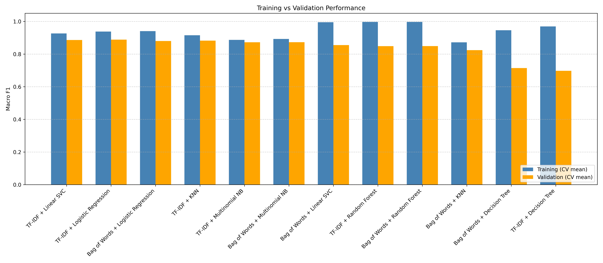

### Training vs validation with 90% reference line

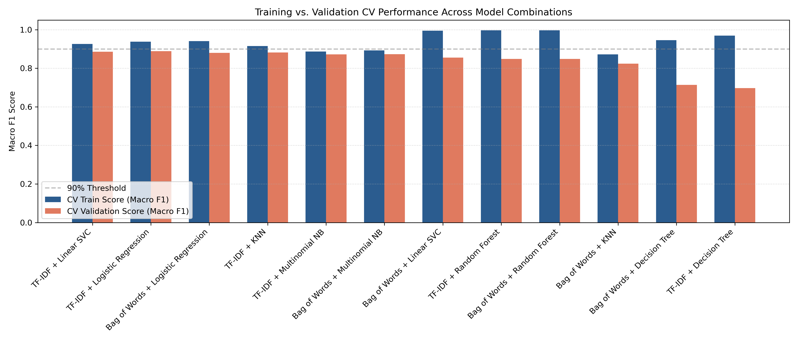

### Macro F-measure: model vs vectorizer

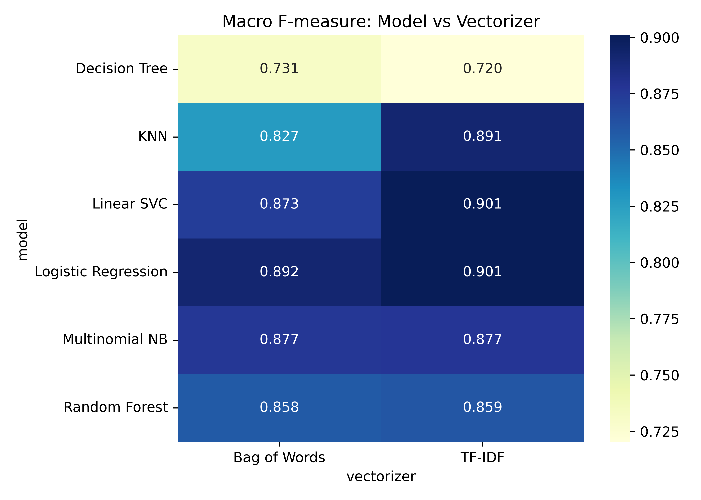

### Performance vs training cost

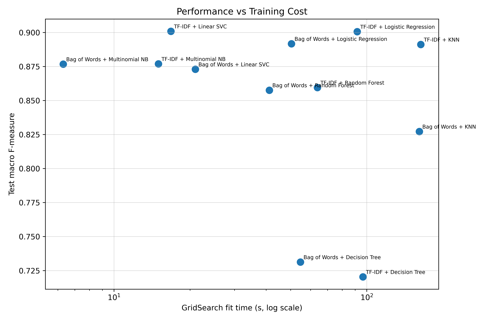

### Learning curves for every model

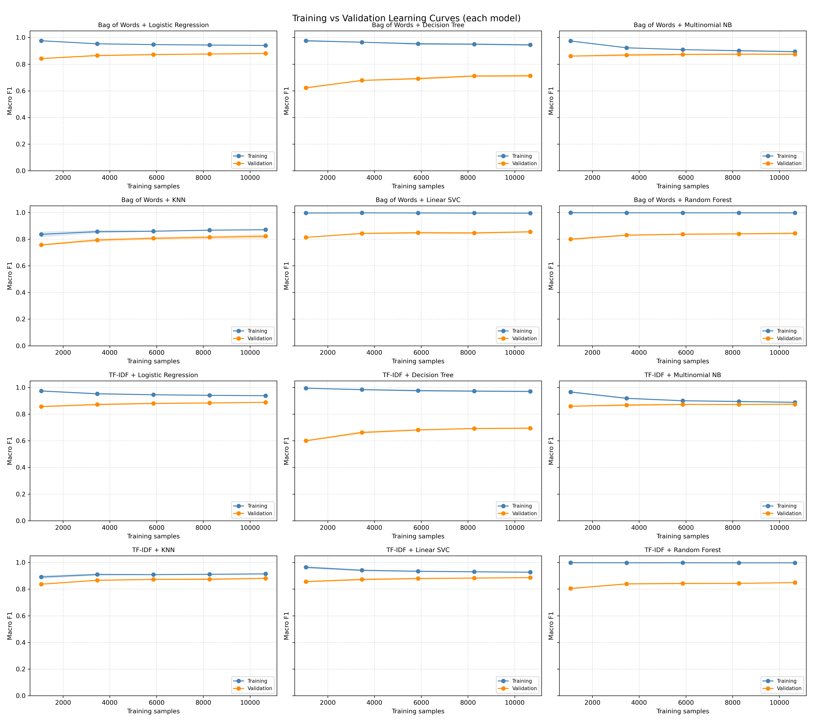

## 7. Interpretation (code included)

Section 7 of the notebook produces the following files in `outputs/`:
- Confusion matrices (counts and row-normalised) for all 12 models
- Training vs validation CV plot with a 90% reference line
- Classification report and top misclassified class pairs for the best model
- Top discriminative terms per class (TF-IDF + Logistic Regression and TF-IDF + Linear SVC)
- Random Forest (top 20) and Decision Tree (top 15) feature importances

### Confusion matrix of the best model (TF-IDF + Linear SVC)

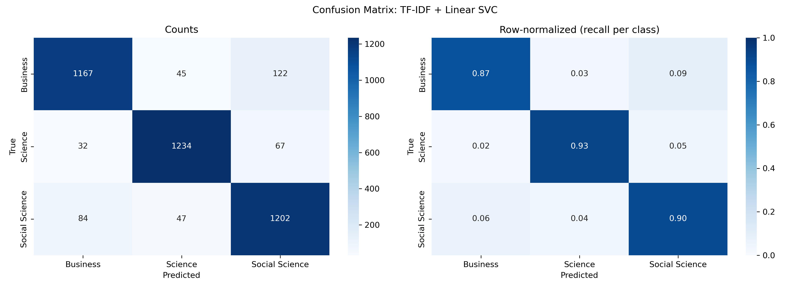

<details>
<summary><b>Confusion matrices for all 12 models</b> (counts and row-normalised recall)</summary>

#### Bag of Words

**Bag of Words + Logistic Regression**

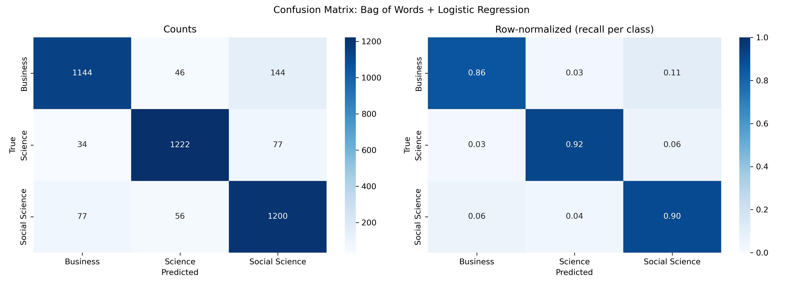

**Bag of Words + Decision Tree**


**Bag of Words + Multinomial NB**


**Bag of Words + KNN**

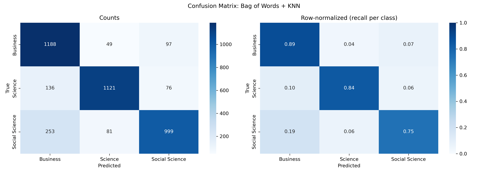

**Bag of Words + Linear SVC**

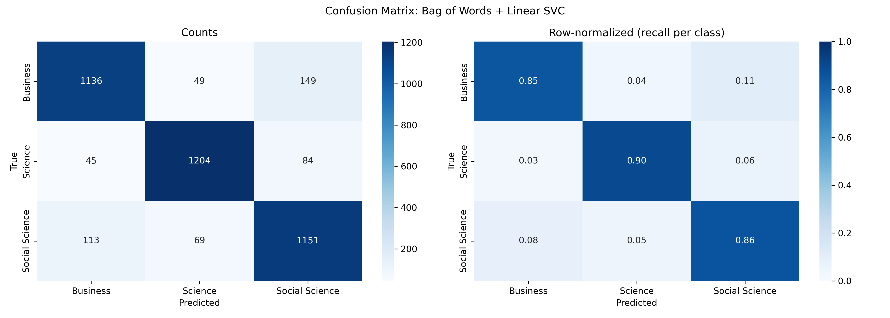

**Bag of Words + Random Forest**

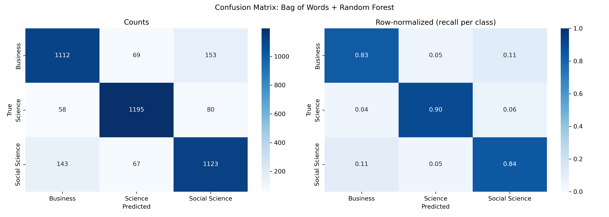

#### TF-IDF

**TF-IDF + Logistic Regression**

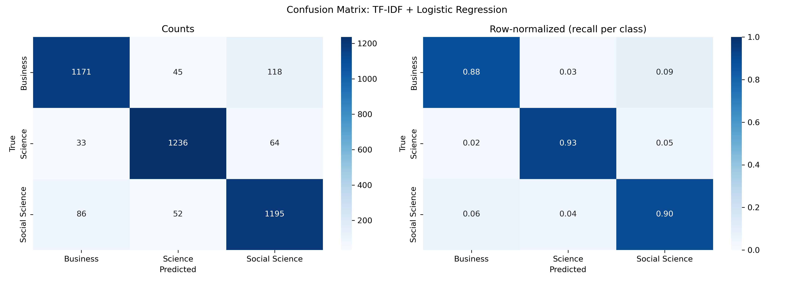

**TF-IDF + Decision Tree**

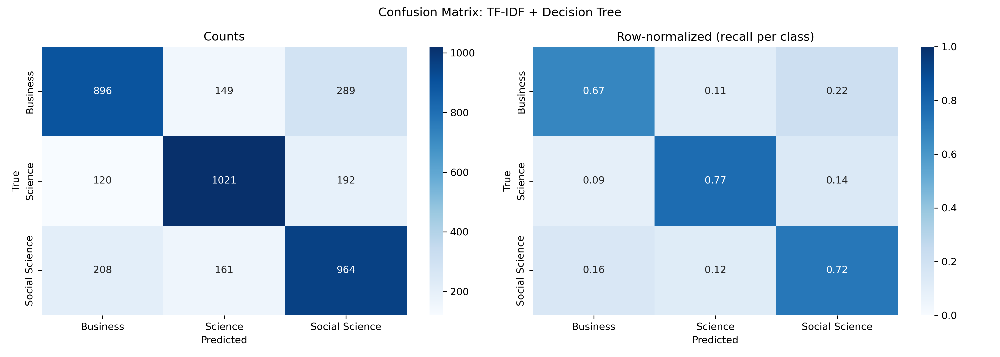

**TF-IDF + Multinomial NB**

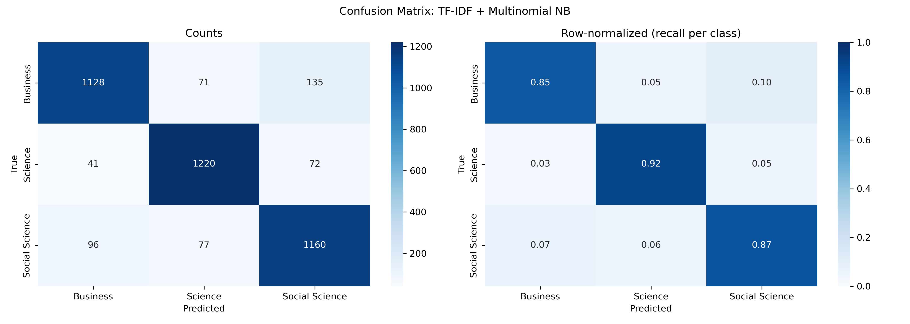

**TF-IDF + KNN**

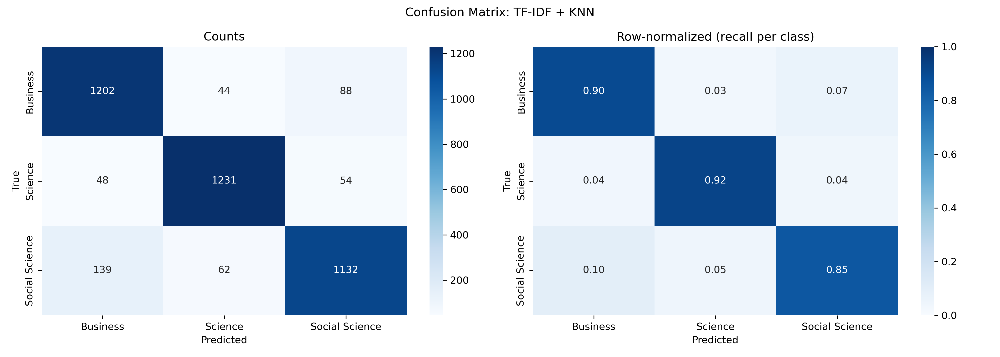

**TF-IDF + Linear SVC**


**TF-IDF + Random Forest**

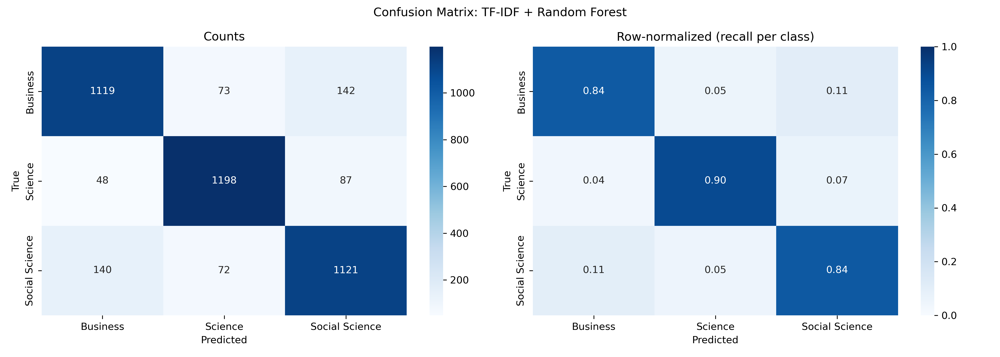

</details>

### Top discriminative terms: TF-IDF + Logistic Regression

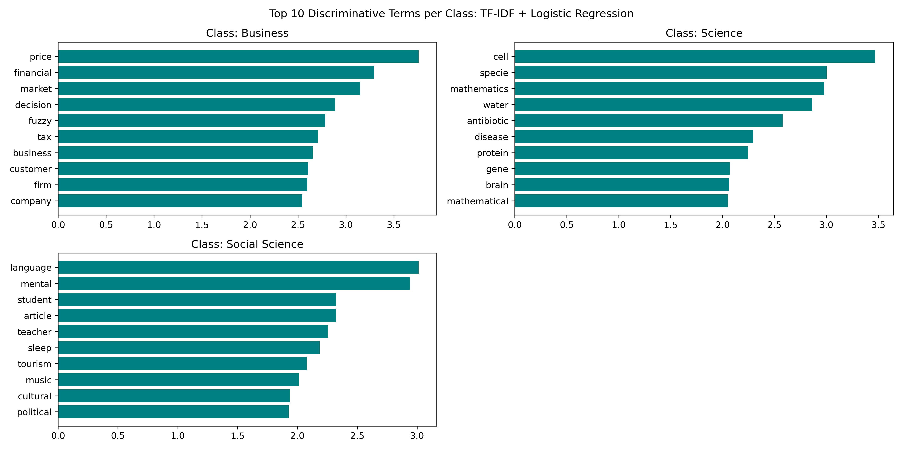

### Top discriminative terms: TF-IDF + Linear SVC

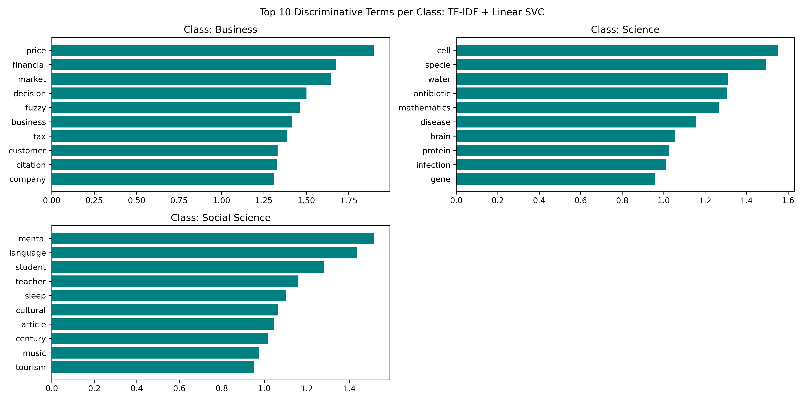

### Random Forest feature importances

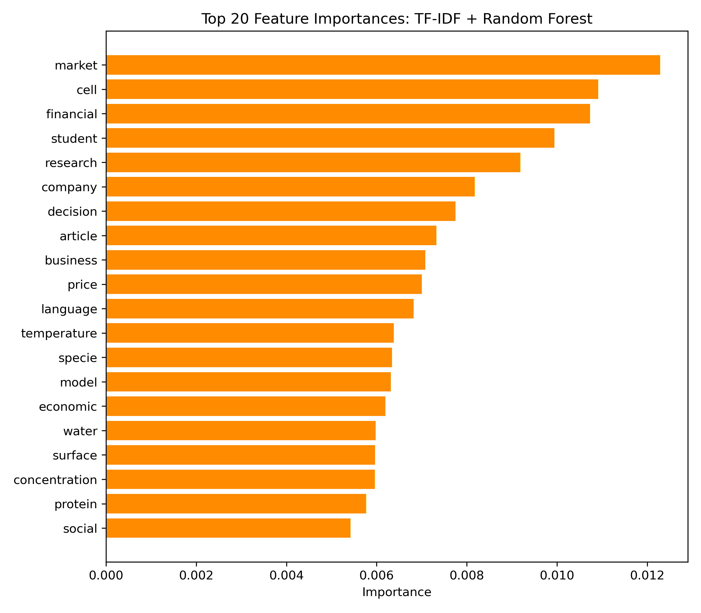

### Decision Tree feature importances

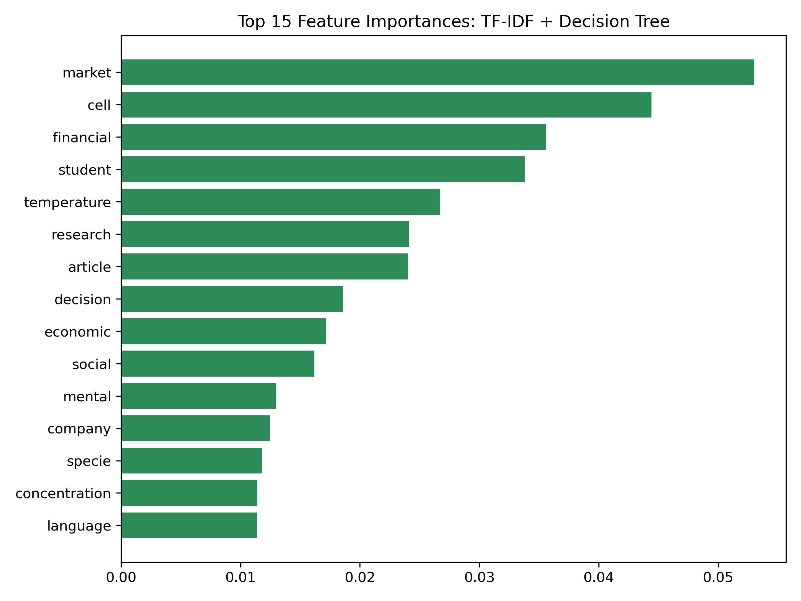

Note: the saved notebook only contains outputs up to the training-vs-validation plot (section 6.3).
The learning curves, heatmap, cost plot and all of sections 7 - 8 have no saved outputs, so re-run
the notebook to generate them.

## 8. Saved models

Each best pipeline (vectorizer + classifier) is saved with `joblib` to `outputs/saved_models/` as
`pipeline_<combo>.pkl`, plus the overall best as `best_model.pkl`.

Files in `outputs/saved_models/`:

- `best_model.pkl`
- `pipeline_Bag_of_Words_vs_Decision_Tree.pkl`
- `pipeline_Bag_of_Words_vs_KNN.pkl`
- `pipeline_Bag_of_Words_vs_Linear_SVC.pkl`
- `pipeline_Bag_of_Words_vs_Logistic_Regression.pkl`
- `pipeline_Bag_of_Words_vs_Multinomial_NB.pkl`
- `pipeline_Bag_of_Words_vs_Random_Forest.pkl`
- `pipeline_TF-IDF_vs_Decision_Tree.pkl`
- `pipeline_TF-IDF_vs_KNN.pkl`
- `pipeline_TF-IDF_vs_Linear_SVC.pkl`
- `pipeline_TF-IDF_vs_Logistic_Regression.pkl`
- `pipeline_TF-IDF_vs_Multinomial_NB.pkl`
- `pipeline_TF-IDF_vs_Random_Forest.pkl`

```python
import joblib
model = joblib.load("outputs/saved_models/best_model.pkl")
print(model.predict(["We study the effect of interest-rate shocks on firm investment ..."]))
```

## 9. Predict on new abstracts with `run.py`

`run.py` is a small desktop app (Tkinter) that loads the saved best pipeline and classifies new
abstracts. It looks for the model at `outputs/saved_models/best_model_pipeline.pkl`, then
`outputs/saved_models/best_model.pkl`.

```
python run.py
```

**Tab 1 - Single Abstract**
- Paste an abstract, or click **Upload .txt...** to load a text file into the box.
- Click **Classify Abstract** to see the predicted class. Models with probabilities (e.g. Logistic
  Regression) show percentages; Linear SVC shows decision scores instead.

**Tab 2 - Batch Upload (CSV / TXT)**
- Choose a `.csv` or `.txt` file with **Browse...**.
- **CSV:** type the name of the column that holds the abstracts (default `Abstract`, not case-sensitive).
- **TXT:** pick how the file is split into abstracts: one per line, blank-line-separated blocks, or the whole file as one.
- Click **Run Predictions**. Results are saved to `outputs/predictions_<input file name>.csv` with a
  `Predicted_Category` column (and `Confidence` when the model supports probabilities). Blank rows are skipped.

_Screenshot not found: `screenshots/run_py_batch_prediction.png`._

_Batch tab after running predictions on a CSV of about 20,000 abstracts._

**Notes**
- The models were trained on preprocessed text (lemmatised, stopwords removed), so `run.py` applies
  the same NLTK preprocessing to new text. Install NLTK (`pip install nltk`) and let it download its
  resources on first launch. If NLTK is missing, the window shows "NLTK not available, simplified
  cleaning was used" and predictions can be less accurate.
- Running a large file takes a while; a progress bar is shown and the window stays responsive.

## Output files

```
Project1_26566019_structured.ipynb
run.py                           (prediction app)
abstracts.csv
screenshots/
  run_py_batch_prediction.png
outputs/
  predictions_<input>.csv        (written by run.py)
  model_comparison_results.csv
  metrics_comparison.png
  training_vs_validation.png
  learning_curves_all_models.png
  fmeasure_heatmap.png
  performance_vs_time.png
  cm_<combo>.png                 (12 files)
  train_vs_val_performance.png
  top_terms_<combo>.png
  rf_feature_importances.png
  dt_feature_importances.png
  saved_models/
    pipeline_<combo>.pkl         (12 files)
    best_model.pkl
```

## Requirements

Python 3.9+ and:

```
requests pandas numpy matplotlib seaborn scikit-learn nltk tqdm joblib
```

NLTK resources downloaded by the notebook: `punkt`, `punkt_tab`, `stopwords`, `wordnet`,
`averaged_perceptron_tagger`, `averaged_perceptron_tagger_eng`.

## How to run

1. Install the requirements above.
2. Open `Project1_26566019_structured.ipynb` in Jupyter or Colab and run all cells in order.
3. Section 1 needs internet access (OpenAlex API). Set `MAILTO` to your own email for the API polite pool.
   To skip collection, place an existing `abstracts.csv` next to the notebook and start from section 2.
4. Section 5.4 (GridSearchCV) is the slowest step; section 6.4 (learning curves) also takes several minutes.

## Known notes

- Section 2.1 has leftover unused lines (`Dataset = ''`, commented `os.listdir`).
- Some abstracts are non-English (e.g. Turkish and Greek titles appear in the sample) despite the `language:en` filter; they lose characters during the ASCII normalisation step.
- Rankings are based on a single 80/20 split, so differences of a few tenths of a point (e.g. SVC vs Logistic Regression) are not conclusive.
